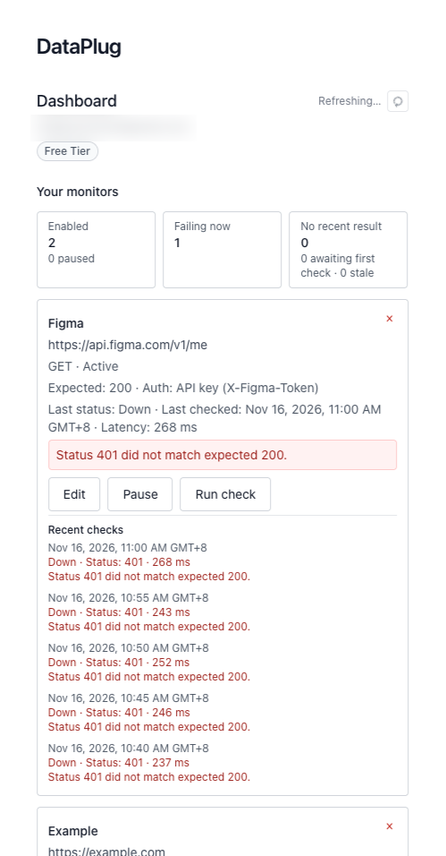

# Joseph Kim

Personal portfolio site for Joseph Kim. Plain HTML, CSS, and a small vanilla script. English only. No framework, build step, analytics, or cookies.

Expected public URL: <https://jklabs-ai.github.io/>

GitHub Pages source: branch `main`, folder `/` (repository root). `.nojekyll` is present so Pages serves the files as they are.

## Preview locally

From this directory:

```bash
python3 -m http.server 8000
```

Then open <http://localhost:8000>.

Opening `index.html` directly (`file://`) cannot load Writing. Browsers block `fetch` of `data/posts.json` from a file URL. Use the local server above.

## Theme

The first visit follows the operating system colour scheme. The header control switches theme and saves only that choice in `localStorage` under the key `theme`. After a manual choice, system changes are ignored until the saved value is cleared. If storage is blocked, the control still switches the current view and the page does not throw.

Without JavaScript, colours follow the system preference and the theme control is hidden. Section links in the header stay available.

## Update a writing card

Each card is one object in `data/posts.json`. The page sorts by `date`, newest first, and shows three cards. Load more reveals the rest. Show less returns to those three. Refer to a card by its `id`.

Current placeholders:

| id | date |
| --- | --- |
| `prototype-to-workflow` | 2026-11-12 |
| `test-the-pain` | 2026-10-27 |
| `questions-before-a-model` | 2026-10-08 |
| `deployment-not-demos` | 2026-09-15 |
| `first-user` | 2026-08-19 |
| `stop-a-private-beta` | 2026-07-02 |

To change a title, teaser, or date, edit that object. `summary` is the sentence under the title. `date` is `YYYY-MM-DD` and is shown as a date-only value. `id` stays the same when the words change, so later edits still find the same note.

A coming-soon card has `"status": "coming-soon"` and no `url`. Clicking it opens a short dialog. Its preview is drawn by the page, with the word “placeholder” across it.

When the note is published, change that same object:

```json
{
  "id": "prototype-to-workflow",
  "title": "Where an AI prototype becomes a workflow",
  "date": "2026-11-12",
  "summary": "One line summary.",
  "status": "published",
  "url": "https://www.linkedin.com/in/josephkimhk/",
  "platform": "LinkedIn",
  "image": "/assets/img/posts/prototype-to-workflow.png"
}
```

`url` must be `http` or `https`. `platform` is a label such as LinkedIn, Medium, Substack, X, or Site. `image` is optional and must be a local file under `/assets/img/posts/`. A published card opens that URL in a new tab. `featured` is reserved and does not change order. An empty array shows: “Writing is on the way. For now, I post on LinkedIn.”

## Add a project screenshot

Each project card already has a preview frame under its status line. Put the file in `assets/img/projects/`, then replace that card’s `.shot-placeholder` with an image. Do not point an `img` at a file that is not there yet.

```html
<figure class="project-shot">
  
</figure>
```

Use `tracenote-1.png` for TraceNote. The frame uses the card’s 22px corner radius. If a listed image fails to load, the script removes that figure. Write alt text that describes the picture.

## Add the resume

Place the file at `assets/resume/Joseph-Kim-Resume.pdf`. Then remove the Resume TODO comments in `index.html` and restore:

- Hero: Resume as the primary button, before LinkedIn, opening the PDF in a new tab. LinkedIn returns to an outlined button.
- Background: the sentence “Full details in my resume.” linking to the PDF.
- Contact: a Resume link with Email, LinkedIn, and GitHub.

Until that file exists, those links stay omitted so the site does not advertise a missing PDF.

## Share image

`assets/img/og-image.png` is a 1200×630 placeholder: a snapshot of the hero. The page points Open Graph and Twitter at it. To replace it with the plain name card, and [Pillow](https://python-pillow.org/) is already installed, run:

```bash
python3 scripts/make_og_image.py
```

That writes a 1200×630 black-on-white image. If Pillow is not installed, screenshot `assets/img/og-image-template.html` at 1200×630 CSS pixels and save that PNG to `assets/img/og-image.png`. Then add the Open Graph and Twitter image tags in `index.html`. Do not rename the HTML template to `.png`.
